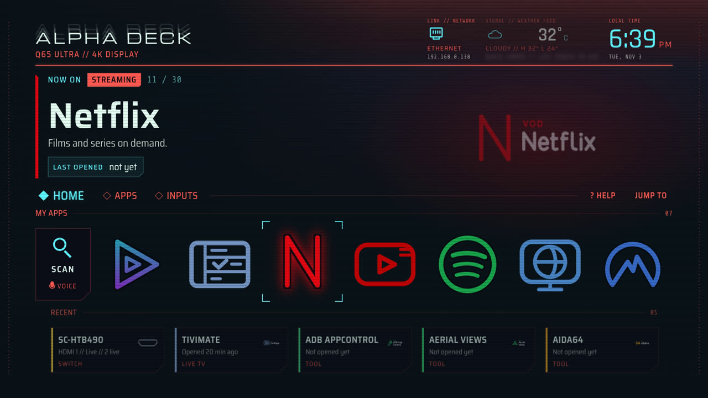
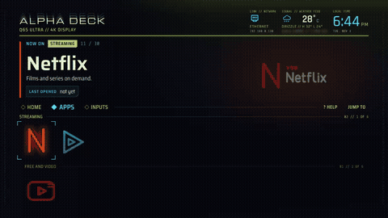
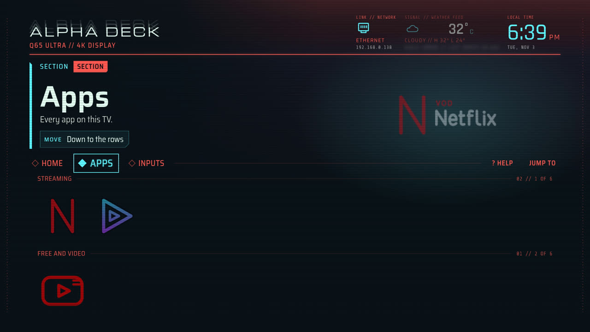
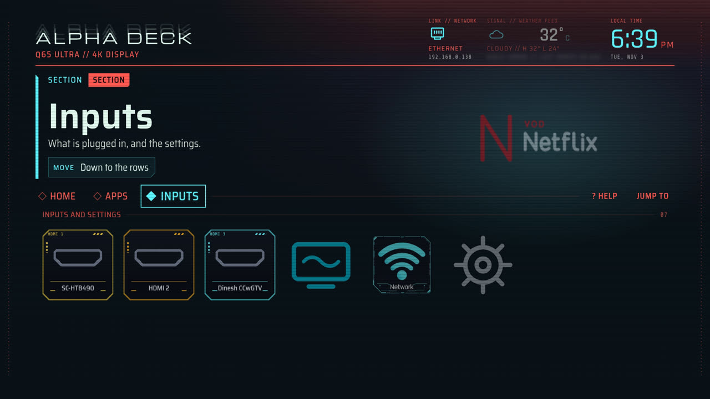
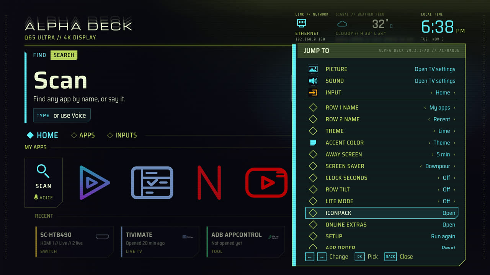
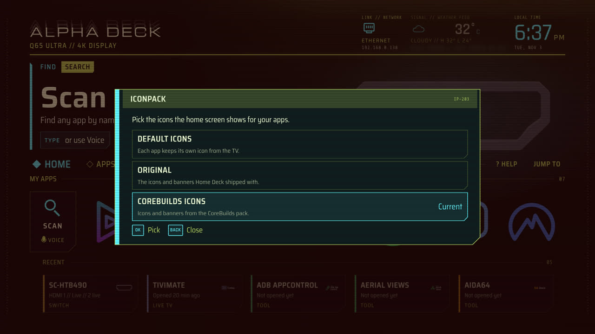
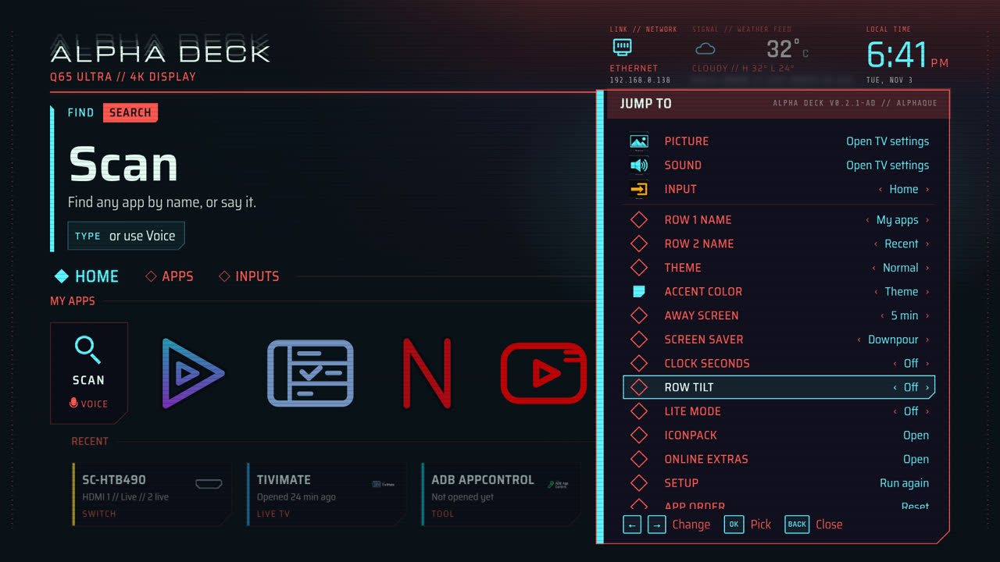
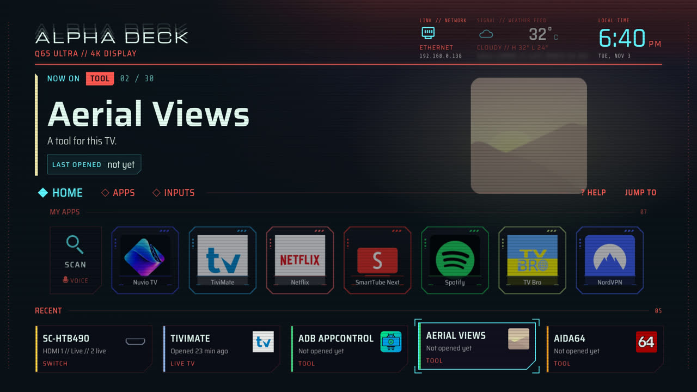
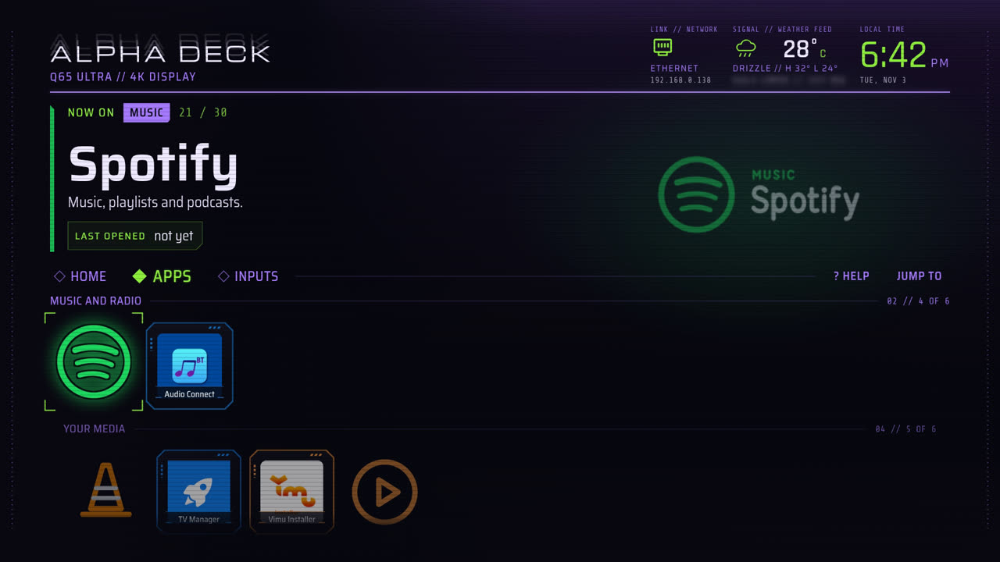
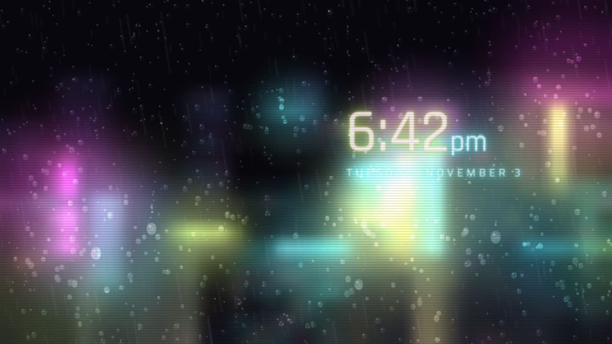

# Alpha Deck

A lightweight launcher and home screen for Google TV and Android TV, based on [Home Deck](https://github.com/glidiandev/home-deck) by
Glidian. Your apps as big glowing tiles, the art of whatever you're on filling the background, a music bar that shows
what's playing, and your HDMI inputs named after the devices on them. No ads, no recommendation rows, and it works
offline.



[](docs/media/tour.mp4)

A 30-second tour of Home, Apps, Inputs and Jump To: [watch the video](docs/media/tour.mp4).

**Android TV 8.0+ · offline by default · free and open source (MIT)**

> [!NOTE]
> Alpha Deck is fan-made and free. It isn't affiliated with or endorsed by Glidian or any app maker. App names and
> logos belong to their owners.

## What it does

From Home Deck:

- **Home** with search, up to seven favorites, and **Jump back in** (the apps you opened last). A live HDMI input
  leads that row.
- **Apps**, grouped by kind, with tile art for popular apps and a colored badge for everything else.
- **Inputs**: your HDMI ports with their device names, Live TV, Network and Settings.
- **Music bar** showing what's playing, with play/pause.
- **Jump To** (hold Back): picture and sound settings, inputs, theme (Normal, Lime or Violet), accent color,
  clock seconds, away screen, Lite mode, online extras, setup, app order and About.
- **Away screen and screen saver**: a dim drifting clock or the rainy neon city.
- **Optional weather** from Open-Meteo, off until you turn it on.

Added in Alpha Deck:

- **Icon packs**: pick Default, CoreBuilds or the original art in Jump To.
- **Row tilt**: Classic, Pinned left, Subtle or Off.
- **Away screen Off** option.
- **Live network tile** that updates when the connection changes, plus network status in the top bar.
- **Cleaner top bar**: realigned clock block that scales with the screen, no "OK Open/Switch" hint, and no
  "Updated" on the weather line.
- **Own app id** (`com.alphaque.alphadeck`), so it installs alongside Home Deck.

| | |
|---|---|
|  |  |
|  |  |
|  |  |
|  |  ([video](docs/media/rain.mp4)) |

## Using it

| Remote | What it does |
|---|---|
| Arrows | Move around. Going past the end of a row carries on to the next. |
| OK | Open |
| Hold OK | Options: open, pin, move, info, uninstall (on inputs: switch, name, audio out) |
| Back | Climb back up to the row, the tab, then Home |
| Hold Back | Jump To |
| Play/pause | Play or pause what's in the music bar |

To move an app, hold OK, pick **Move**, slide it with the arrows and press OK. **Jump To > App order** resets
everything.

## Music bar (optional)

Turn it on in **Jump To > Music bar**. It needs notification access but only reads what's playing. If your TV has no
screen for that, use adb:

```bash
adb shell cmd notification allow_listener com.alphaque.alphadeck/dev.glidian.homedeck.NowPlayingListener
```

## Screen saver

Pick **Alpha Deck** in Settings > Device Preferences > Screen saver, or use adb:

```bash
adb shell settings put secure screensaver_components com.alphaque.alphadeck/dev.glidian.homedeck.ScreenSaver
```

## Install

Alpha Deck isn't on the Play Store; you install it yourself with adb. You'll need a computer with
[adb](https://developer.android.com/tools/releases/platform-tools) on the same network as the TV.

1. On the TV, turn on Developer options (Settings > Device Preferences > About, press OK on **Build** seven times),
   then turn on **USB debugging** or **Network debugging** in Developer options.
2. Find the TV's IP address (Settings > Network) and connect:
   ```bash
   adb connect 192.168.1.50:5555
   ```
   Accept the prompt on the TV.
3. Download the latest `alpha-deck-buildN-release.apk` from [Releases](../../releases) (N is the build number) and
   install it:
   ```bash
   adb install alpha-deck-buildN-release.apk
   ```
   Updating works the same way: `adb install -r alpha-deck-buildN-release.apk` keeps your favorites and settings.

Alpha Deck now shows up in your apps. To make it what the Home button opens:

```bash
adb shell cmd package set-home-activity com.alphaque.alphadeck/dev.glidian.homedeck.HomeActivity
```

Some TVs keep sending Home to the stock launcher anyway. If yours does, switch the stock launcher off (this doesn't
uninstall anything):

```bash
# Android TV
adb shell pm disable-user --user 0 com.google.android.tvlauncher
# Google TV
adb shell pm disable-user --user 0 com.google.android.apps.tv.launcherx
```

> [!IMPORTANT]
> If you switch the stock launcher off, turn it back on **before** you ever remove Alpha Deck. See
> [Uninstall](#uninstall).

> [!TIP]
> Installing another app that can be a home screen can make the TV forget your choice. If Home stops opening Alpha
> Deck, run the `set-home-activity` command again.

### Switching back

List the home screens on your TV, then point Home at the one you want:

```bash
adb shell cmd package query-activities --brief -a android.intent.action.MAIN -c android.intent.category.HOME
adb shell cmd package set-home-activity <name from the list>
```

## Uninstall

> [!WARNING]
> If you switched the stock launcher off, turn it back on **first**. Otherwise the TV has nothing to show when you
> press Home.

```bash
# Android TV
adb shell pm enable com.google.android.tvlauncher
# Google TV
adb shell pm enable com.google.android.apps.tv.launcherx
```

Then remove Alpha Deck:

```bash
adb shell cmd notification disallow_listener com.alphaque.alphadeck/dev.glidian.homedeck.NowPlayingListener
adb uninstall com.alphaque.alphadeck
```

## Privacy

Your favorites, names and settings stay on the TV. Nothing is sent anywhere. The internet permission is only for the
optional weather, which is off until you turn it on.

## Build from source

You'll need JDK 17 and the Android SDK (API 34).

```bash
./gradlew assembleDebug
adb install -r app/build/outputs/apk/debug/app-debug.apk
```

Release APKs are built by GitHub Actions on this repo.

## Credits

- Based on [Home Deck](https://github.com/glidiandev/home-deck) by [Glidian](https://glidian.dev), which grew out of
  [KIDŌ](https://github.com/glidiandev/kido) and [cleanyourtv](https://github.com/Gathin23/cleanyourtv) by Gathin.
- Alpha Deck changes by [dineshalphaque](https://github.com/dineshalphaque).
- CoreBuilds icon and banner art from [Core Builds](https://github.com/brevityA/CoreBuildsApps), MIT,
  © 2026 Core Builds. Its license is in [`app/src/main/assets/www/icons/LICENSE-CoreBuilds`](app/src/main/assets/www/icons/LICENSE-CoreBuilds).
  App names and logos belong to their owners; Core Builds' MIT license grants no trademark rights.
- Fonts under the SIL Open Font License: Michroma, Rajdhani, Saira and Share Tech Mono.
- Weather from [Open-Meteo](https://open-meteo.com).

## License

MIT, © 2026 Glidian (Home Deck) and © 2026 Alphaque (Alpha Deck changes). See [LICENSE](LICENSE). The CoreBuilds art is MIT, © 2026 Core Builds (see above).
